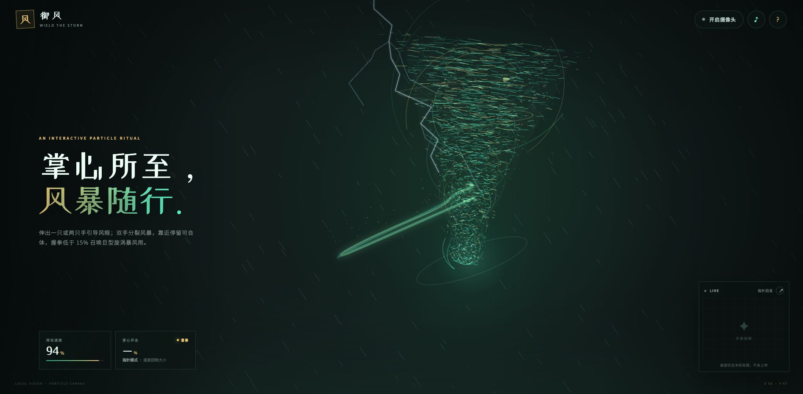

# 御风 · 粒子龙卷风互动体验

基于 Canvas 粒子、Web Audio 与 MediaPipe 手部识别的交互式龙卷风网页。掌心所至，风暴随行——粒子风柱、旋转拖尾、雨幕与闪电随手掌位置、开合程度和挥动速度实时变化。

**▶ 在线体验：<https://shenyuhong7919-create.github.io/tornado-interaction/>**

打开后可选择「先用手体验」（鼠标 / 触控，无需摄像头即可看全套效果），或「开启摄像头」进入手势识别模式（需 HTTPS，上面的地址可直接授权）。

## 效果预览



## 交互玩法

| 操作 | 效果 |
| --- | --- |
| 单手掌心移动 | 龙卷风跟随掌心位置 |
| 掌心开合程度 | 控制风暴大小与强度 |
| 快速挥动 | 挥动速度越高，越容易触发降雨与雷暴 |
| 同时伸出双手 | 分裂出两个龙卷风，各随一只手 |
| 两手靠近并停留 | 触发合体风暴 |
| 握拳（张开度低于 15%） | 召唤巨型旋涡暴风雨 |
| 指示型手势 | 切换青绿 / 蓝色主题，风暴粒子与标题同步变色 |
| 无摄像头时 | 鼠标 / 触控模式，可体验全部视觉效果 |

## 界面说明

- **顶栏**：开启 / 关闭摄像头、「风」字印记、风声音效开关、玩法帮助
- **摄像头面板**：实时识别预览（LIVE 标记，可缩放），显示手部追踪状态
- **实时数据**：挥动速度（%）、掌心开合（%）、天气状态（平静 / 降雨 / 雷暴等）
- **首屏文案**：随主题与状态变化的氛围提示

## 技术说明

- 纯静态页面：HTML + CSS + JavaScript，无构建步骤、无后端
- **Canvas 2D 粒子系统**：数千粒子的风柱与旋转拖尾，按帧计算速度场与位置
- **Web Audio**：程序化风声音效 + 本地雨声 / 雷声 / 闪电音效素材，可一键开关
- **MediaPipe Hands**：手部关键点识别（按需加载），映射为掌心位置、开合度与挥动速度
- 若摄像头不可用或未授权，自动降级为鼠标 / 触控模式，视觉与音效不受影响

浏览器要求：Chrome / Edge 等现代浏览器。摄像头模式需要 HTTPS 或 `localhost` 安全上下文。

## 本地运行

```bash
python3 -m http.server 8000
```

访问 `http://localhost:8000`。直接双击 `index.html` 也可浏览基础效果，但摄像头识别需通过 HTTP 服务或 HTTPS 访问。

## 文件结构

```
index.html    页面结构
style.css     界面与响应式样式
app.js        粒子、手势、天气、音效与交互逻辑
音效文件/      雨声、雷声、闪电音效素材
效果预览.jpg   README 预览图
```

## 素材与致谢

- 音效素材位于 `音效文件/`，用于页面内雨、雷、闪电的实时混音
- 手部识别基于 Google 的 [MediaPipe Hands](https://developers.google.com/mediapipe)
